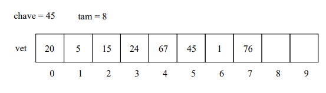
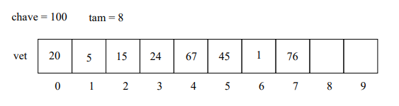
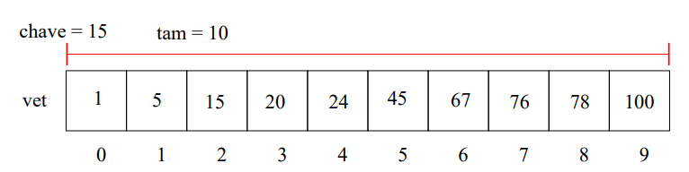
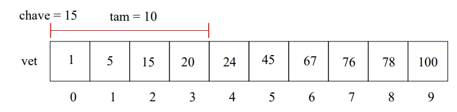
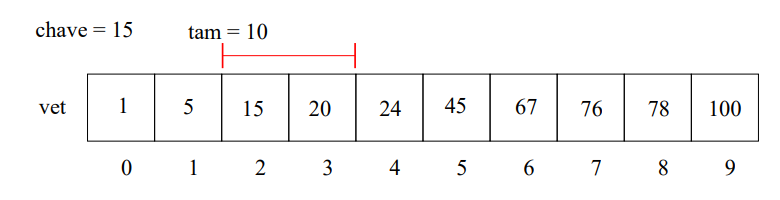
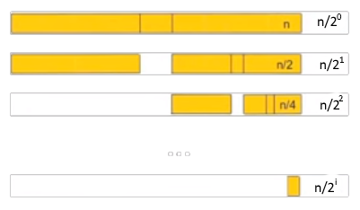

# Pesquisa Linear e Pesquisa Binária
 
## Motivação
 
Uma das funções mais recorrentes em programação é a **busca por alguma informação**. Seja a busca por alguma informação em arquivo, banco de dados ou valor armazenado em memória.
 
### Problema
 
> Temos uma coleção de elementos, onde cada elemento possui um identificador/chave único. Recebemos uma chave para busca e devemos encontrar o elemento dentro da coleção que possui a mesma chave ou identificar que não existe nenhum elemento com a chave dada.
 
Para fins didáticos, iremos usar inicialmente um **array simples e homogêneo**, mas as aplicações com busca podem ser em outras estruturas ou com outras chaves de pesquisa.
 
## Definindo a função de pesquisa
 
Definindo a função `pesquisa`, que deve retornar o índice que contém a chave de pesquisa. Os argumentos da função são:
 
- `lista`: coleção de elementos inteiros
- `chave`: chave de pesquisa a ser consultada no vetor

 
Em **JavaScript**, a assinatura da função pesquisa ficaria assim:
 
```javascript
/**
 * Pesquisa uma chave em uma lista.
 * @param {number} chave    - valor a ser procurado
 * @param {number[]} lista  - coleção de elementos inteiros
 * @returns {number} índice da chave na lista, ou -1 se não existir
 */
function pesquisa(chave, lista) {
  let pos = 0;
  // ...
  return pos;
}
```
 
### Exemplo 1
 
Para o seguinte conjunto de parâmetros a função deverá retornar **5**:
 

 
```javascript
const array = [20, 5, 15, 24, 67, 45, 1, 76];
pesquisa(45, array); // → 5
```

### Exemplo 2
Para o seguinte conjunto de parâmetros a função deverá retornar **-1**, pois a chave não foi encontrada no vetor:
 

 
```javascript
const array = [20, 5, 15, 24, 67, 45, 1, 76];
pesquisa(100, array); // → -1
```
 
---
 
## Pesquisa Sequencial
 
A pesquisa sequencial é o algoritmo mais simples de busca:
 
1. Percorra todo o vetor comparando a chave com o valor do elemento de cada posição;
2. Se for igual para algum elemento, então retorne a posição deste;
3. Se o vetor todo foi percorrido, devolva `-1`;

### Exemplo — chave encontrada (chave = 45)
 

 
| Passo | Índice | Comparação | Resultado |
|:-----:|:------:|:-----------|:----------|
| 1 | 0 | `45 == 20` | falso, continua |
| 2 | 1 | `45 == 5`  | falso, continua |
| 3 | 2 | `45 == 15` | falso, continua |
| 4 | 3 | `45 == 24` | falso, continua |
| 5 | 4 | `45 == 67` | falso, continua |
| 6 | 5 | `45 == 45` | **verdadeiro → retorna 5** |
 

 
### Exemplo — chave não encontrada (chave = 100)
 

 
| Passo | Índice | Comparação | Resultado |
|:-----:|:------:|:-----------|:----------|
| 1 | 0 | `100 == 20` | falso, continua |
| 2 | 1 | `100 == 5`  | falso, continua |
| 3 | 2 | `100 == 15` | falso, continua |
| 4 | 3 | `100 == 24` | falso, continua |
| 5 | 4 | `100 == 67` | falso, continua |
| 6 | 5 | `100 == 45` | falso, continua |
| 7 | 6 | `100 == 1`  | falso, continua |
| 8 | 7 | `100 == 76` | falso, fim do vetor → **retorna -1** |
 
## Exercício
 
> Implemente a função de pesquisa sequencial em javascript com uma estrutura de repetição.
>
> **Obs:** os arrays em JavaScript possuem os métodos `indexOf`, `find` e `findIndex`. Não utilize estes métodos.
 
## Implementação
 
A pesquisa sequencial pode ser implementada utilizando alguma estrutura de repetição:
 
Em **JavaScript**:
 
```javascript
function buscaSeq(n, lista) {
  for (let i = 0; i < lista.length; i++) {
    if (lista[i] === n) {
      return i;
    }
  }
  return -1;
}
 
// Testes
const vet = [20, 5, 15, 24, 67, 45, 1, 76];
console.log(buscaSeq(45, vet));  // 5
console.log(buscaSeq(100,vet)); // -1
```
 
O `for...of` com `entries()` é o deixa o código um pouco mais limpo:
 
```javascript
function pesquisaSeq(n, lista) {
  for (const [i, v] of lista.entries()) {
    if (v === n) {
      return i;
    }
  }
  return -1;
}
```
 
> **Atenção:** use sempre `===` (igualdade estrita) em vez de `==`. Com `==` o JavaScript faz conversão implícita de tipos, e `"45" == 45` seria verdadeiro — a busca encontraria uma string onde se esperava um número.
 
---
 
# Pesquisa Sequencial em Vetor Ordenado
 
Caso tenhamos um vetor com elementos **ordenados**, podemos melhorar a eficiência do algoritmo de busca da seguinte forma:
 
1. Percorra o vetor comparando a chave com o valor de cada posição
2. Se for igual para alguma posição, então retorne esta posição
3. **Se o valor de alguma posição for maior que o valor da chave, retorne `-1`**
4. Se o vetor todo foi percorrido, devolva `-1`
A busca sequencial em vetor ordenado pode ser implementada apenas adicionando uma condição ao *loop*.
 
Em **JavaScript**:
 
```javascript
function pesquisaSeqOrd(n, listaOrdenada) {
  for (let i = 0; i < listaOrdenada.length; i++) {
    const v = listaOrdenada[i];
    if (v === n) {
      return i;
    }
    if (v > n) {
      return -1; // já passou do ponto onde a chave estaria
    }
  }
  return -1;
}
 
// Testes
const vetOrd = [1, 5, 15, 20, 24, 45, 67, 76, 78, 100];
console.log(pesquisaSeqOrd(15, vetOrd)); // 2
console.log(pesquisaSeqOrd(30, vetOrd)); // -1 (para no 45, sem varrer o resto)
```
 
> A parada antecipada não muda a complexidade de pior caso (ainda é **O(n)**), mas reduz bastante o número médio de comparações quando a chave não existe.
 
---
 
# Pesquisa Binária
 
A pesquisa binária é um algoritmo um pouco mais sofisticado do que a interação convêncional, porém também é mais eficiente. Para utilizá-la **e necessário que o vetor esteja ordenado** pelos valores da chave.
 
A ideia básica consiste na **divisão e conquista**: divisão do conjunto ordenado em conjuntos menores enquanto se faz a comparação.
 
## O algoritmo
 
1. Verifique se a chave de busca é igual ao valor da posição do **meio** do vetor. Caso seja igual, devolva esta posição.
2. Caso o valor desta posição seja **maior**, então repita o processo, mas considere que o vetor tem metade do tamanho, indo até a posição anterior à do meio.
3. Caso o valor desta posição seja **menor**, então repita o processo, mas considere que o vetor tem metade do tamanho e inicia na posição seguinte à do meio.

### Exemplo 1 — buscando a chave 15
 
**Passo 1** — intervalo completo (`tam = 10`), meio na posição 4 → valor 24. Como `15 < 24`, a busca continua na metade da esquerda:
 
> Para calcular o meio devemos calcular a média da soma do índice inicial [0] e do índice final [9]. É necessário fazer o arredondamento para não ficarmos com índice do tipo float
**inicio** = 0
**fim** = 9
**meio** = 4


 
**Passo 2** — intervalo `[0, 3]`, meio na posição 1 → valor 5. Como `15 > 5`, a busca continua na metade da direita:
**inicio** = 0
**fim** = 3
**meio** = 1 


 
**Passo 3** — intervalo `[2, 3]`, meio na posição 2 → valor 15. `15 == 15` → **retorna 2**: **inicio** = 2
**fim** = 3
**meio** = 2
 

 
## Implementação
 
Em **JavaScript** a implementação pode ser feita na forma iterativa:
 
```javascript
function pesquisaBinaria(n, listaOrdenada) {
  let inicio = 0;
  let fim = listaOrdenada.length - 1;
 
  while (inicio <= fim) {
    const meio = Math.floor((inicio + fim) / 2);
 
    if (n === listaOrdenada[meio]) {
      return meio;
    } else if (n > listaOrdenada[meio]) {
      inicio = meio + 1;   // descarta a metade da esquerda
    } else {
      fim = meio - 1;      // descarta a metade da direita
    }
  }
  return -1;
}
 
// Testes
const vetOrd = [1, 5, 15, 20, 24, 45, 67, 76, 78, 100];
console.log(pesquisaBinaria(15, vetOrd, 15));  // 2
console.log(pesquisaBinaria(100,vetOrd)); // 9
console.log(pesquisaBinaria(30, vetOrd));  // -1
```
  
### Versão recursiva
 
A divisão e conquista fica ainda mais evidente na forma recursiva:
 
```javascript
function pesquisaBinariaRec(listaOrdenada, n, inicio = 0, fim = listaOrdenada.length - 1) {
  if (inicio > fim) {
    return -1; // caso base: intervalo vazio
  }
 
  const meio = Math.floor((inicio + fim) / 2);
 
  if (n === listaOrdenada[meio]) {
    return meio;
  }
  if (n > listaOrdenada[meio]) {
    return pesquisaBinariaRec(listaOrdenada, n, meio + 1, fim);
  }
  return pesquisaBinariaRec(listaOrdenada, n, inicio, meio - 1);
}
 
const vetOrd = [1, 5, 15, 20, 24, 45, 67, 76, 78, 100];
console.log(pesquisaBinariaRec(15,vetOrd, 15)); // 2
console.log(pesquisaBinariaRec(99,vetOrd)); // -1
```
 
### Exercício: 

Faça uma versão contendo registros dos valores (inicio, meio, fim, iteração) e os imprimindo ao longo da execução instrumentada 
 
---
 
# Analisando os Algoritmos
 
## Pesquisa sequencial
 
- Considerando uma situação ideal, o algoritmo de pesquisa pode encontrar o resultado na **primeira comparação**.
- Na pior situação, o algoritmo poderá realizar **N comparações**, onde N é o tamanho do vetor, até encontrar o elemento ou retornar `-1`.
## Pesquisa binária
 
- Considerando uma situação ideal, o algoritmo de busca pode encontrar o resultado na **primeira comparação**.
- Na pior situação, o algoritmo poderá realizar a seguinte quantidade de comparações:

 
Até encontrar o elemento, temos feito `i + 1` comparações. A relação entre `i` e `n` é tal que, quando encontrarmos o elemento no pior caso, somente com 1 elemento restante, temos:
 
```
1 = n / 2^i
n = 2^i
log₂(n) = i
```
 
## Comparativo
 
| Algoritmo | Pré-requisito | Melhor caso | Pior caso |
|:---|:---|:---:|:---:|
| Busca sequencial | nenhum | O(1) | **O(n)** |
| Busca sequencial em vetor ordenado | vetor ordenado | O(1) | **O(n)** |
| Busca binária | vetor ordenado | O(1) | **O(log₂ n)** |
 
## Exemplo numérico
 
Para uma pesquisa em um registro contendo **18 milhões de valores**, considerando que cada comparação leva **10 milionésimos de segundo**, no pior caso temos:
 
- **Busca sequencial:** `10 / 1.000.000 × 18.000.000 = 180 segundos = 3 minutos`
- **Busca binária:** `log₂(18.000.000) ≈ 24,1 comparações` → `10 / 1.000.000 × 24,1 = 0,000241 s ≈ 0,24 milissegundos`
O mesmo cálculo em JavaScript:
 
```javascript
const n = 18_000_000;
const tempoPorComparacao = 10 / 1_000_000; // 10 microssegundos, em segundos
 
const tempoSequencial = tempoPorComparacao * n;
const tempoBinaria = tempoPorComparacao * Math.log2(n);
 
console.log(`Sequencial: ${tempoSequencial.toFixed(2)} s`);
console.log(`Binária:    ${(tempoBinaria * 1000).toFixed(3)} ms`);
// Sequencial: 180.00 s
// Binária:    0.241 ms
```
 
E uma comparação empírica do número de comparações, contando cada acesso:
 
```javascript
function contaComparacoesSequencial(lista, n) {
  let comparacoes = 0;
  for (let i = 0; i < lista.length; i++) {
    comparacoes++;
    if (lista[i] === n) break;
  }
  return comparacoes;
}
 
function contaComparacoesBinaria(listaOrdenada, n) {
  let inicio = 0;
  let fim = listaOrdenada.length - 1;
  let comparacoes = 0;
 
  while (inicio <= fim) {
    const meio = Math.floor((inicio + fim) / 2);
    comparacoes++;
    if (listaOrdenada[meio] === n) break;
    if (n > listaOrdenada[meio]) inicio = meio + 1;
    else fim = meio - 1;
  }
  return comparacoes;
}
 
// Vetor ordenado de 1 a 1.000.000; procuramos o último elemento (pior caso da sequencial)
const grande = Array.from({ length: 1_000_000 }, (_, i) => i + 1);
const chave = 1_000_000;
 
console.log('Sequencial:', contaComparacoesSequencial(grande, chave)); // 1000000
console.log('Binária:   ', contaComparacoesBinaria(grande, chave));    // 20
```
 
## Qual a desvantagem da busca binária?
 
> O arranjo usado **não deve ter alterações que modifiquem sua estrutura ordenada**.
 
Ou seja: manter o vetor ordenado tem um custo. Se o conjunto muda com frequência, é preciso pagar o preço de reordenar (ou de inserir na posição correta) a cada alteração — e esse custo pode superar o ganho obtido na busca.
 

 
## Perguntas?

 